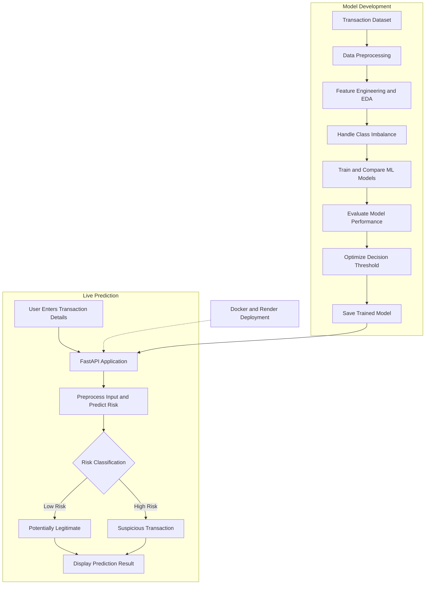

# 🛡️ Intelligent Transaction Risk Detection

An end-to-end Machine Learning application designed to identify potentially fraudulent financial transactions using classification algorithms, transaction behavior analysis, and optimized prediction thresholds. The project provides a FastAPI web application, REST API endpoints, and Docker-based deployment support.

🔗 **Live Demo:** https://fraud-detection-dz3c.onrender.com/

💻 **GitHub Repository:** https://github.com/naveen057/fraud-detection

## 📌 Project Overview

Financial transaction fraud is a major challenge for digital payment systems. Detecting suspicious transactions accurately is important for reducing financial losses while avoiding unnecessary alerts for legitimate transactions.

This project uses machine learning techniques to analyze transaction characteristics and estimate the likelihood of fraudulent activity. It demonstrates the complete ML workflow, from data preparation and model evaluation to API development and deployment.

## 🎯 Objectives

- Identify potentially fraudulent financial transactions.
- Analyze transaction patterns and behavioral features.
- Handle class imbalance in fraud classification.
- Compare multiple machine learning algorithms.
- Evaluate models using appropriate classification metrics.
- Optimize the classification threshold based on estimated fraud-related costs.
- Deploy predictions through a FastAPI application.
- Monitor API health and prediction latency.

## ✨ Key Features

- **Transaction Risk Prediction:** Estimates whether a transaction may be fraudulent.
- **Feature Engineering:** Uses transaction characteristics and behavioral patterns.
- **Imbalanced Data Handling:** Supports techniques such as class weighting and SMOTE.
- **Model Evaluation:** Measures classification performance using multiple metrics.
- **Threshold Optimization:** Selects a prediction threshold based on evaluation and estimated costs.
- **REST API:** Supports individual and batch predictions.
- **API Monitoring:** Provides health checks and inference latency statistics.
- **Docker Support:** Packages the application for containerized deployment.
- **Web Interface:** Provides a browser-based interface for interacting with the application.

## 🛠️ Technologies Used

| Category | Technologies |
|---|---|
| Programming Language | Python |
| Data Processing | Pandas, NumPy |
| Machine Learning | Scikit-learn, XGBoost |
| Imbalanced Data | SMOTE, Class Weighting |
| Model Evaluation | Precision, Recall, F1-score, PR-AUC, ROC-AUC |
| API Development | FastAPI, Pydantic, Uvicorn |
| Model Persistence | Joblib |
| Containerization | Docker |
| Deployment | Render |
| Testing | Pytest |

## 📊 Dataset

The project uses a synthetically generated transaction dataset to simulate normal and fraudulent transaction behavior.

**Dataset characteristics:**
- Approximately 101,646 transactions
- Approximately 2,500 simulated users
- Simulated transaction activity over 60 days
- Fraud prevalence of approximately 1.584%

### Features Used

The dataset includes transaction and behavioral features such as:

- Transaction amount
- Transaction time
- Merchant category
- Payment channel
- Foreign transaction indicator
- New-device indicator
- Distance from home
- Account age
- Recent transaction frequency
- Average transaction amount over a previous period
- Time since the previous transaction

**Note:** The dataset is synthetic and does not represent real customer transactions. Performance on synthetic data may differ significantly from performance on real financial transactions.

## 🔄 Project Flow Diagram

The following diagram illustrates the complete workflow of the **Intelligent Transaction Risk Detection** system, from transaction data preparation to fraud-risk prediction and deployment.



### Workflow Explanation

1. **Transaction Dataset:** Generate and prepare financial transaction records.
2. **Data Preprocessing:** Prepare numerical and categorical input features.
3. **Feature Engineering:** Extract useful transaction and behavioral information.
4. **Model Training:** Compare machine learning classification algorithms.
5. **Model Evaluation:** Evaluate model performance using precision, recall, F1-score, PR-AUC, and ROC-AUC.
6. **Threshold Optimization:** Select a decision threshold for fraud-risk classification.
7. **FastAPI Integration:** Load the saved model and process incoming transactions.
8. **Prediction:** Display the estimated transaction risk.
9. **Deployment:** Host the containerized application using Docker and Render.

## ⚙️ Machine Learning Workflow

1. **Data Generation:** Generate synthetic financial transactions with simulated fraud patterns.
2. **Data Preprocessing:** Prepare data and handle numerical and categorical features.
3. **Feature Engineering:** Extract transaction frequency and customer-behavior information.
4. **Exploratory Data Analysis:** Investigate class imbalance and transaction patterns.
5. **Model Training:** Train and compare classification algorithms.
6. **Imbalance Handling:** Evaluate class weighting and SMOTE techniques.
7. **Hyperparameter Tuning:** Use RandomizedSearchCV and time-aware validation where configured.
8. **Threshold Optimization:** Select a classification threshold based on estimated business costs.
9. **Model Evaluation:** Evaluate predictions on held-out data.
10. **API Development:** Expose model predictions using FastAPI.
11. **Deployment:** Package and deploy the application using Docker and Render.

## 🤖 Machine Learning Models

The project explores the following algorithms:

- Logistic Regression
- Random Forest Classifier
- Gradient Boosting / XGBoost

Model selection considers more than accuracy because fraud datasets are often highly imbalanced.

### Evaluation Metrics

- **Precision:** Measures how many transactions predicted as fraudulent are actually fraudulent.
- **Recall:** Measures how many fraudulent transactions the model identifies.
- **F1-score:** Balances precision and recall.
- **PR-AUC:** Evaluates precision-recall performance, particularly useful for imbalanced datasets.
- **ROC-AUC:** Measures the model's ability to distinguish between the two classes.

## 📁 Project Structure

```text
fraud-detection/
├── app/
│   ├── main.py
│   ├── schemas.py
│   ├── latency.py
│   ├── templates/
│   └── static/
├── fraud/
│   ├── config.py
│   ├── data.py
│   ├── features.py
│   ├── models.py
│   ├── predictor.py
│   ├── resampling.py
│   └── threshold.py
├── models/
├── reports/
├── scripts/
├── tests/
├── Dockerfile
├── docker-compose.yml
├── render.yaml
├── requirements.txt
├── requirements-dev.txt
└── README.md
```

*The directory structure above is illustrative. Adjust it to match the actual files in your repository.*

## 💻 Installation and Setup

### 1. Clone the Repository

```bash
git clone https://github.com/naveen057/fraud-detection.git
cd fraud-detection
```

### 2. Create a Virtual Environment

For Windows PowerShell:

```powershell
python -m venv .venv
.\.venv\Scripts\Activate.ps1
```

### 3. Install Dependencies

```bash
pip install -r requirements.txt
```

### 4. Run the Application

From the project root directory:

```bash
uvicorn app.main:app --host 0.0.0.0 --port 8000
```

### 5. Access the Application

- **Web Interface:** http://localhost:8000/
- **API Documentation:** http://localhost:8000/docs
- **Health Check:** http://localhost:8000/health

Make sure the model artifacts, templates, and other required project files are present before starting the application.

## 🌐 API Endpoints

The application provides endpoints for predictions and monitoring.

| Endpoint | Method | Purpose |
|---|---|---|
| `/` | GET | Web interface |
| `/predict` | POST | Predict the risk of an individual transaction |
| `/predict/batch` | POST | Process multiple transactions |
| `/metrics` | GET | View inference latency statistics |
| `/model-info` | GET | View model information and threshold details |
| `/health` | GET | Check application health |
| `/docs` | GET | Interactive Swagger API documentation |

Availability of individual endpoints depends on the application's current implementation.

## 🐳 Run with Docker

Build the Docker image:

```bash
docker build -t transaction-risk-detection .
```

Run the container:

```bash
docker run --rm -p 8000:8000 transaction-risk-detection
```

Open http://localhost:8000/ to access the application.

## ☁️ Live Deployment

The application is deployed on Render.

**Live Application:** https://fraud-detection-dz3c.onrender.com/

You can use the deployed application to explore the available transaction risk prediction interface.

## 🔮 Future Improvements

- Evaluate the model on real-world or publicly available fraud datasets.
- Add model explainability using SHAP.
- Introduce authentication and API rate limiting.
- Monitor model drift and changing transaction patterns.
- Improve probability calibration.
- Add automated model retraining pipelines.
- Build a dashboard for fraud trends and model performance.
- Integrate real-time transaction streaming.

## 👨‍💻 Author

**Thura Venkata Naveen**

- GitHub: https://github.com/naveen057
- Project Repository: https://github.com/naveen057/fraud-detection

## 📄 License

Add an appropriate open-source license if you intend to distribute this project under one.
