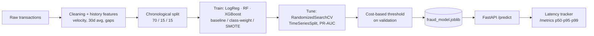
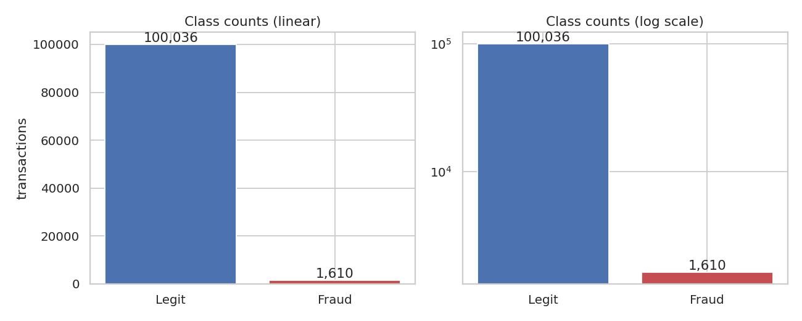
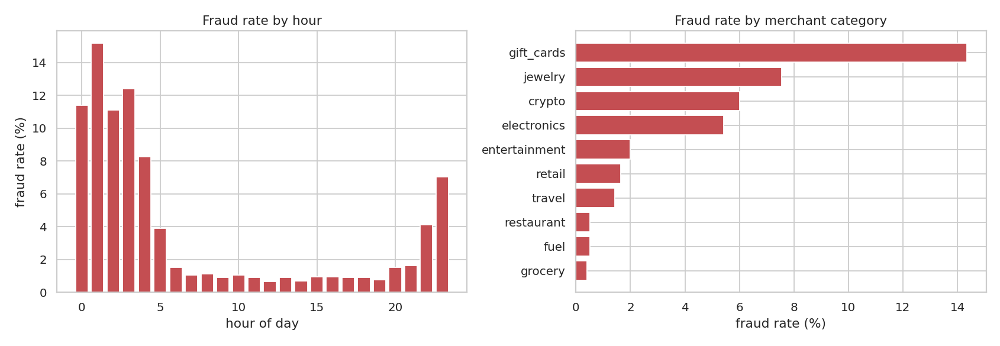
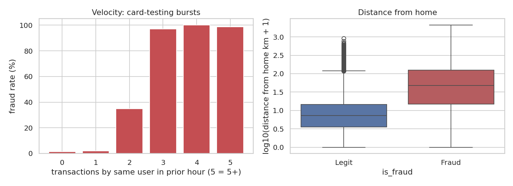
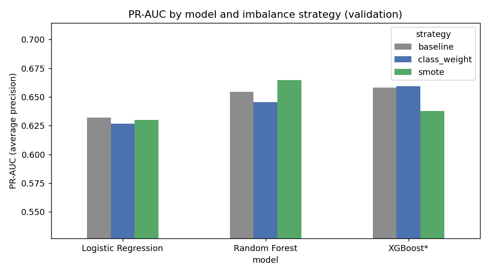
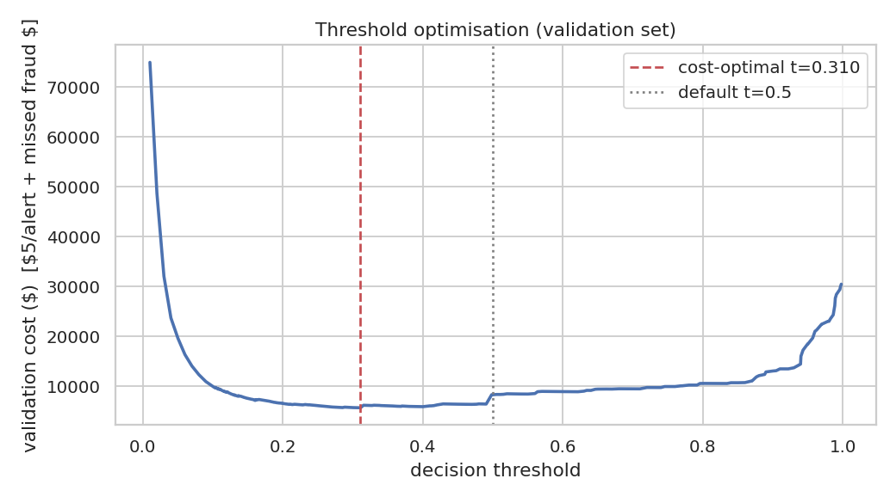
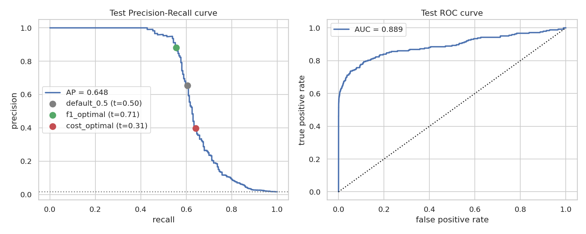
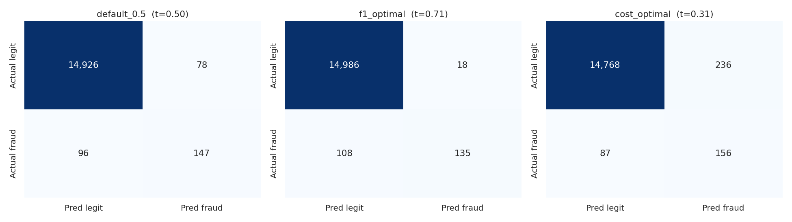
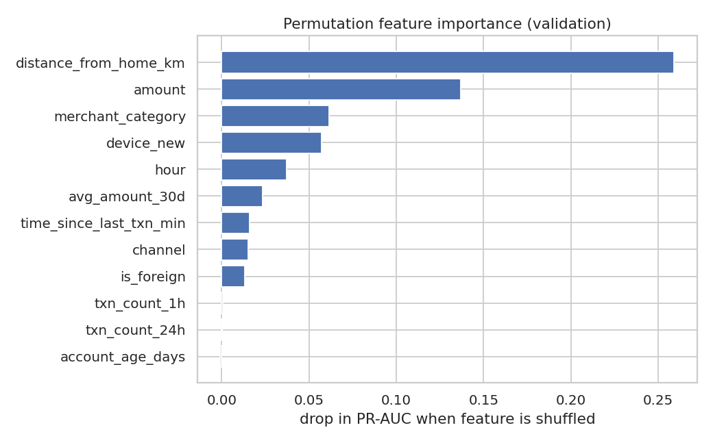

# 🛡️ Real-Time Fraud Detection System

End-to-end machine-learning project that scores card transactions for fraud in **~5 ms**, built around the
problems that make fraud detection hard: **extreme class imbalance (1 : 62)**,
**decision-threshold selection driven by business cost**, and **production latency monitoring**.

 
 

| | |
|---|---|
| **Stack** | Python · pandas · scikit-learn · **XGBoost** · **Random Forest** · **SMOTE** (imbalanced-learn) · **FastAPI** · **Docker** |
| **Data** | 101,646 simulated transactions · 2,500 users · 60 days · 1.584% fraud |
| **Headline result** | PR-AUC **0.648**, ROC-AUC **0.889** on a held-out *future* test period |
| **Business impact** | Cost-optimised threshold cuts simulated fraud losses + review cost by **77%** vs. no model |
| **Latency** | p50 **5.0 ms**, p99 **8.6 ms** per transaction (in-process, 1 CPU) |

> ⚠️ **Read this first – honest scope notes**
> * The dataset is **synthetic** (real card data is private). The generator (`fraud/data.py`) models card-testing bursts, account takeovers and
>   deliberately *subtle* fraud that looks normal, so absolute scores are **not** comparable to real-world or Kaggle benchmarks. The pipeline
>   accepts any data with the same columns.
> * The FastAPI app and Docker image were written for this stack but **could not be executed in the build sandbox** (no `fastapi`/Docker available). The model
>   bundle, the shared `FraudPredictor` inference code and the core unit tests *were* run; `tests/test_api.py` and the CI workflow exercise the API and the Docker build on your machine/GitHub.
> * The results below were produced in an environment without network access, where `xgboost` / `imbalanced-learn` could not be installed. The code
>   **automatically falls back** to scikit-learn's `HistGradientBoostingClassifier` (same gradient-boosted-trees family; labelled **"XGBoost\*"** in tables) and a NumPy SMOTE
>   implementation. Run `make all` with `requirements-dev.txt` installed to regenerate every number and figure with real XGBoost + imbalanced-learn
>   (the backend used is stored in `reports/final_metrics.json`).

---

## 1. Architecture



```
fraud-detection/
├── fraud/                  # importable package (shared by training AND serving)
│   ├── config.py           #   paths, feature lists, cost assumptions
│   ├── data.py             #   transaction simulator, time-based split
│   ├── features.py         #   history features + derived features (no train/serve skew)
│   ├── resampling.py       #   SMOTE (imbalanced-learn, NumPy fallback)
│   ├── models.py           #   model factory, preprocessing pipeline, search spaces
│   ├── threshold.py        #   metrics + cost-based threshold optimisation
│   └── predictor.py        #   framework-independent inference wrapper
├── app/                    # FastAPI service (main.py, schemas.py, latency.py)
├── scripts/                # one script per project stage (01 … 05)
├── tests/                  # unit + API tests
├── models/fraud_model.joblib
├── reports/                # metrics JSON/CSV + figures used in this README
├── Dockerfile · docker-compose.yml · render.yaml · Makefile · .github/workflows/ci.yml
```

---

## 2. Stage 1 – Data collection & preprocessing  (`scripts/01_generate_data.py`)

* **Collection:** `fraud/data.py` simulates 60 days of card activity with three fraud patterns – *card-testing bursts* (many tiny online payments in minutes),
  *account takeover* (large, foreign/new-device, night-time) and *subtle fraud* (almost indistinguishable from the cardholder's normal behaviour).
* **Validation / cleaning:** missing values (0), duplicates (0) and non-positive amounts (0) are checked and removed (`reports/data_quality.json`).
* **Historical features** (computed from *strictly earlier* transactions only – no leakage): `txn_count_1h`, `txn_count_24h`, `avg_amount_30d`, `time_since_last_txn_min`.
  Row-wise features (`log_amount`, `is_night`, `amount_to_avg_ratio`) live **inside the sklearn pipeline**, so training and serving share identical code.
* **Encoding / scaling:** one-hot for `merchant_category` and `channel`; standard scaling for numerics.
* **Split:** *chronological* 70 / 15 / 15 (train → validation → test). Random splits would leak the future into the past and overstate performance.

| Split | Rows | Fraud rate |
|---|---|---|
| Train | 71,152 | 1.61% |
| Validation | 15,247 | 1.48% |
| Test | 15,247 | 1.59% (243 frauds) |

## 3. Stage 2 – Exploratory data analysis  (`scripts/02_eda.py`)

Key findings (figures in `reports/figures/eda_*.png`):

* **Imbalance:** only 1.584% of transactions are fraud → accuracy is useless (a model that always says "legit" scores 98.4%). We optimise **PR-AUC / recall / precision / cost** instead.
* **Velocity is the strongest burst signal:** fraud rate is 1.3% with 0 prior transactions in the last hour but **97%** with 3 (card-testing).
* **Behavioural flags:** new device → 13.28% fraud (vs 0.88%); foreign → 11.62% (vs 1.24%).
* **Time:** night-time (23:00–06:00) fraud rate 9.05% vs 1.05% by day.
* **Merchant risk:** gift cards (14.33%), jewelry (7.55%), crypto (6.01%) and electronics (5.42%) are high-risk.
* **Relative amount matters more than raw amount:** fraud amounts look ordinary globally but are unusual *for that customer* (`amount_to_avg_ratio`).





## 4. Stage 3 – Train & compare models  (`scripts/03_compare_models.py`)

Three algorithms × three imbalance strategies, all evaluated on the **validation** set (test set untouched):

* **baseline** – nothing special · **class_weight** – cost-sensitive learning (`balanced` for LR/RF, `sqrt(neg/pos)` `scale_pos_weight` for boosting)
* **SMOTE** – synthetic minority oversampling of the *training split only* (to 20% of the majority count; 71k → 84k rows)

| Model | Imbalance strategy | PR-AUC | ROC-AUC | Best-F1 | F1 @ 0.5 | Fit time (s) |
|---|---|---|---|---|---|---|
| Random Forest | smote | 0.6645 | 0.9159 | 0.6872 | 0.6649 | 20.3 |
| XGBoost* | class_weight | 0.6595 | 0.9172 | 0.6752 | 0.6434 | 0.7 |
| XGBoost* | baseline | 0.6580 | 0.9164 | 0.6722 | 0.6453 | 0.7 |
| Random Forest | baseline | 0.6543 | 0.9084 | 0.6685 | 0.6006 | 16.1 |
| Random Forest | class_weight | 0.6455 | 0.8994 | 0.6618 | 0.6250 | 16.5 |
| XGBoost* | smote | 0.6376 | 0.9070 | 0.6594 | 0.6537 | 4.5 |
| Logistic Regression | baseline | 0.6319 | 0.9136 | 0.6612 | 0.5820 | 0.1 |
| Logistic Regression | smote | 0.6301 | 0.9158 | 0.6446 | 0.5009 | 0.2 |
| Logistic Regression | class_weight | 0.6268 | 0.9149 | 0.6316 | 0.1871 | 0.2 |

*Best-F1 = F1 at the F1-optimal threshold; F1 @ 0.5 = F1 at the naive default threshold. \* = sklearn HistGradientBoosting fallback for XGBoost (see note above).*



**Takeaways**

1. **Tree ensembles beat the linear baseline**, but the margin is modest (~0.63 → ~0.66 PR-AUC) – on this data a ceiling exists because ~35% of fraud is intentionally "subtle".
2. **Differences between the top models are small** (validation has only ~226 frauds, so ±0.01 PR-AUC is within noise). Don't over-read the ranking.
3. **Imbalance handling mainly changes *calibration*, not ranking.** PR-AUC barely moves, but F1 at the default 0.5 threshold swings wildly
   (Logistic Regression + class-weight: F1@0.5 = 0.187 vs best-F1 = 0.632) → **the decision threshold matters more than the resampling trick.**
4. SMOTE helped Random Forest slightly but *hurt* boosting here – interpolating one-hot columns creates unrealistic points. `SMOTENC` or class weights are safer defaults.

## 5. Stage 4 – Hyper-parameter tuning & evaluation  (`scripts/04_tune_and_evaluate.py`)

* **Tuning:** `RandomizedSearchCV` with **`TimeSeriesSplit(3)`** (no future leakage inside CV) and scoring = **average precision (PR-AUC)**.
* **Strategy re-check:** each tuned model is refit with class-weights *and* SMOTE; the winner is chosen on validation PR-AUC.

| Tuned model | Strategy | CV PR-AUC | Validation PR-AUC |
|---|---|---|---|
| XGBoost* | class_weight | 0.6511 | 0.6732 ✅ |
| XGBoost* | smote | 0.6511 | 0.6671 |
| Random Forest | class_weight | 0.6426 | 0.6569 |
| Random Forest | smote | 0.6426 | 0.6648 |

**Winner: XGBoost* + class_weight** · params: `{"min_samples_leaf": 50, "max_leaf_nodes": 31, "max_iter": 250, "max_depth": 3, "learning_rate": 0.05, "l2_regularization": 0.0}`

### Decision-threshold optimisation

With 1.6% fraud the 0.5 cut-off is arbitrary. We choose the threshold on the **validation** set by minimising an explicit business cost:

```
cost = $5 × (#alerts)  +  Σ amount of fraud we missed
```



### Final results on the held-out test period (15,247 transactions, 243 frauds)

| Threshold | t | Precision | Recall | F1 | Caught / Missed | False alerts | Cost |
|---|---|---|---|---|---|---|---|
| Default 0.5 | 0.50 | 0.653 | 0.605 | 0.628 | 147 / 96 | 78 | $7,817 |
| F1-optimal | 0.71 | 0.882 | 0.556 | 0.682 | 135 / 108 | 18 | $8,899 |
| **Cost-optimal (deployed)** | 0.31 | 0.398 | 0.642 | 0.491 | 156 / 87 | 236 | $7,706 |
| No model | – | – | 0 | – | 0 / 243 | 0 | $33,884 |

* **PR-AUC 0.648 · ROC-AUC 0.889** (threshold-independent).
* The deployed threshold (0.31) catches **64%** of fraud at **40%** precision and reduces total cost by **77%** vs. doing nothing.
* **The F1-optimal threshold is *worse* for the business** ($8,899 vs $7,706) because it misses more fraud – a concrete reason not to tune on F1 alone.
* Honest caveat: the cost-optimal threshold is only ~1% cheaper than the default 0.5 here ($7,817) – the cost curve is flat near its minimum. The *bigger* lever is the model itself; the threshold lets you
  **re-tune risk appetite without retraining** (e.g. when review capacity or fraud costs change).




**Most important features** (permutation importance, drop in PR-AUC): `distance_from_home_km` (0.259), `amount` (0.137), `merchant_category` (0.061), `device_new` (0.057), `hour` (0.037).
`txn_count_1h` scores near zero only because `time_since_last_txn_min` carries the same burst signal (correlated features share credit).



---

## 6. Stage 5 – Prediction API  (`app/`)

FastAPI service with strict Pydantic validation, model warm-up on start-up and built-in latency monitoring.

| Endpoint | Purpose |
|---|---|
| `POST /predict` | Score one transaction |
| `POST /predict/batch` | Score up to 1,000 transactions |
| `GET /metrics` | **Rolling latency stats**: mean, p50, p95, p99, max, SLA violations |
| `GET /model-info` | Model name, threshold, training time, metrics |
| `GET /health` | Liveness probe |
| `GET /docs` | Interactive Swagger UI |

```bash
pip install -r requirements-dev.txt
uvicorn app.main:app --port 8000          # then open http://localhost:8000/docs
```

```bash
curl -s -X POST localhost:8000/predict -H 'Content-Type: application/json' -d '{
  "transaction_id": "txn_123456", "amount": 899.99, "hour": 2,
  "merchant_category": "electronics", "channel": "online",
  "is_foreign": 1, "device_new": 1, "distance_from_home_km": 340.0,
  "account_age_days": 420, "txn_count_1h": 1, "txn_count_24h": 2,
  "avg_amount_30d": 48.5, "time_since_last_txn_min": 35.0}'
```
```json
{"transaction_id": "txn_123456", "fraud_probability": 0.997483, "is_fraud": true,
  "risk_level": "high", "threshold": 0.31, "latency_ms": 5.1}
```
*(`fraud_probability` is what the shipped model returns for this exact payload; `latency_ms` is illustrative and will vary by machine.)*

### Latency monitoring

* Middleware times **every** `/predict*` request, adds an **`X-Process-Time-ms`** response header, keeps a rolling window of the last 5,000 latencies and logs a **warning when a request exceeds the SLA** (`LATENCY_SLA_MS`, default 50 ms).
* `GET /metrics` returns p50/p95/p99 – ready to be scraped or wrapped in a Prometheus exporter.
* `python scripts/05_benchmark_api.py --n 500` load-tests a running server end-to-end.

| Measurement (model inference, single transaction, 1 CPU) | Value |
|---|---|
| p50 | 4.97 ms |
| p95 | 7.92 ms |
| p99 | 8.58 ms |
| Batch of 1,000 | 12.8 ms (~78,324 txn/s) |

Network + HTTP overhead is added on top of this; measure it with the benchmark script on your own infrastructure.

**Design note – where do the velocity features come from?** `txn_count_1h`, `avg_amount_30d`, … are *history* features. In production an upstream
**feature store** (e.g. Redis with sliding windows) must supply them in the request. This repo computes them offline for training with the exact same definitions.

## 7. Stage 6 – Deployment

### Docker (local)

```bash
docker build -t fraud-detection-api .
docker run --rm -p 8000:8000 fraud-detection-api
# or
docker compose up --build
curl localhost:8000/health
```

The image is `python:3.12-slim`, runs as a non-root user, includes a `HEALTHCHECK`, and ships the trained model (`models/fraud_model.joblib`, ~0.1 MB).
Runtime dependencies are pinned to the scikit-learn / pandas / numpy versions the model was trained with (pickled sklearn models are not portable across versions).

### Render

1. Push this repo to GitHub (the model file is committed on purpose).
2. On [render.com](https://render.com): **New + → Blueprint** → select the repo. `render.yaml` configures a Docker web service with `/health` as the health check.
3. Once live: `https://<your-service>.onrender.com/docs`.

> The free Render tier sleeps after inactivity, so the first request may take ~30–60 s; use a paid instance for latency-sensitive traffic.

### CI

`.github/workflows/ci.yml` runs the tests and builds the Docker image on every push.

---

## 8. Reproduce everything

```bash
git clone <this-repo> && cd fraud-detection
python -m venv .venv && source .venv/bin/activate
make setup          # pip install -r requirements-dev.txt
make all            # data → EDA → model comparison → tuning/evaluation  (~6 min on 1 CPU)
make test
make api
```

| Stage | Command | Output |
|---|---|---|
| 1 Data | `python scripts/01_generate_data.py` | `data/*.csv`, `reports/data_quality.json` |
| 2 EDA | `python scripts/02_eda.py` | `reports/figures/eda_*.png`, `eda_summary.json` |
| 3 Compare | `python scripts/03_compare_models.py` | `reports/model_comparison.csv` |
| 4 Tune/evaluate | `python scripts/04_tune_and_evaluate.py [--fast]` | `models/fraud_model.joblib`, `reports/final_metrics.json` |
| 5-6 Serve | `uvicorn app.main:app` / Docker | Web form and API on :8000 |

When the API is running, open `http://localhost:8000/` for the Jinja2 transaction-scoring form. Submitting the form sends the transaction to `POST /predict` and displays the model's risk level, fraud probability, threshold, and inference latency. The interactive API docs remain available at `/docs`.

## 9. Limitations & next steps

* **Synthetic data** – validate on real data (e.g. the public Kaggle *Credit Card Fraud Detection* set or PaySim) before drawing business conclusions. Swap in a loader returning the same columns.
* **Small validation/test fraud counts** (~230–245 frauds) → wide confidence intervals; add bootstrap CIs and repeated time-based backtests.
* **Concept drift** – fraudsters adapt. Add drift monitoring (PSI on inputs, rolling recall once chargeback labels arrive) and scheduled retraining.
* **Label delay** – real fraud labels arrive days later; the offline split here assumes immediate labels.
* **Cost model** – the flat $5 review cost and "missed fraud = transaction amount" are assumptions; plug in real numbers (chargeback fees, customer friction).
* **Explainability** – add SHAP reason codes to each alert for analysts.
* **Calibration** – class-weighting/SMOTE distort probabilities; add isotonic/Platt calibration if the score is consumed as a true probability.
* **API hardening** – authentication, rate limiting, request logging to a store, Prometheus exporter, canary deploys.

## 10. License

MIT
"# transaction-fraud-detection" 
"# real-time-fraud-detection-ml" 
# real-time-fraud-detection

# real-time-fraud-detection

